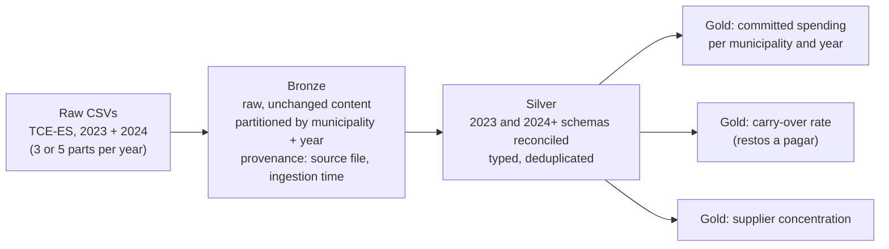

# ES Municipal Spending Pipeline

An end-to-end batch data pipeline over **municipal budget commitments
(*empenhos*) of Espírito Santo, Brazil** — public fiscal-audit data published by
the state court of accounts (TCE-ES).

> **This is a personal portfolio project**, built on open public data. It has not
> been deployed or operated in a production environment.

## Why this dataset

The 78 municipalities reporting to TCE-ES are **independent data providers**.
They share a submission format but not a schema discipline, a release cadence, or
a data steward. That makes this a natural fit for **tenancy-per-provider
ingestion**: each municipality is given isolated custody from the moment the data
lands, before any conforming happens.

The source also evolves without notice. In 2024 the file layout gained three
columns and renamed two, mid-series. Absorbing that break without disturbing
downstream consumers is the central design problem this pipeline solves, and it
is documented rather than papered over.

See [docs/data-profiling.md](docs/data-profiling.md) for the full profile of the
source data.

## Architecture

Medallion layering, with provider isolation established before Bronze.

| Layer | Responsibility | Status |
|---|---|---|
| Bronze | Raw ingestion, no content transformation. Partitioned by provider (municipality) and year. Carries provenance: source file, ingestion timestamp. | Done |
| Silver | Typing, cleaning, and reconciliation of the 2023 and 2024+ schemas. Brazilian decimals and dates parsed, exact 2024 duplicates dropped, rows with no municipality routed to an explicit `_unknown` partition. | Done |
| Gold | Business-ready aggregates answering named questions (below). Design notes in [docs/gold-design.md](docs/gold-design.md). | Done |



The Airflow DAG runs these three layers in order, and each layer has its own
data quality checks.

### Questions the Gold layer answers

1. Committed spending per municipality and year, comparable across municipalities.
2. **Carry-over rate (*restos a pagar*) per municipality and year** — how much was
   committed but left unpaid within the fiscal year. A real fiscal-health signal.
3. Supplier concentration per municipality — the share of spending going to the
   largest creditors.

## Stack

| Component | Role | Status |
|---|---|---|
| PySpark | Layer transformations | Done |
| Apache Airflow | Single end-to-end DAG, Bronze → Silver → Gold | Done (`dags/es_empenhos_pipeline.py`) |
| Docker Compose | One-command local stack (`Dockerfile`, `docker-compose.yml`) | Done |
| Custom PySpark checks | Data quality, one per layer (`src/es_empenhos/quality/`) | Done |
| pytest | One test module per layer (`tests/test_bronze.py`, `test_silver.py`, `test_gold.py`) | Done |

Nothing in this table is claimed as working until it is marked otherwise.

## Environment

Development runs on **WSL2**, on the Linux filesystem rather than through
`/mnt/*`, because Airflow requires POSIX and Spark I/O over the Windows interop
mount is markedly slower.

| | Version |
|---|---|
| OS | Ubuntu 22.04 (WSL2 on Windows 11) |
| Python | 3.10.12 |
| Java | OpenJDK 17.0.20 |
| Spark | 3.5.9 (Scala 2.12.18) |

Under WSL2 the hostname resolves to a loopback address, and Spark then binds to
the interop interface and warns on every start. Exporting `SPARK_LOCAL_IP=127.0.0.1`
before running the pipeline keeps it on localhost and silences the warning.

On the full 2023+2024 input (~13 GB on disk, several GB in memory after parsing)
Spark's default driver heap (~1 GB) will OOM in the Silver stage. Export
`PYSPARK_SUBMIT_ARGS='--driver-memory 8g --conf spark.driver.maxResultSize=2g pyspark-shell'`
before running on the full data. The committed `sample/` runs on the default.

## Data is not in this repository

The source data is roughly 13 GB and is deliberately excluded from version
control. The pipeline processes **2023 and 2024** — one year of each source
schema, which is the minimum that exercises the schema reconciliation. Extending
to further years is a configuration change, since Bronze partitions by year.

To obtain the data, download the *Empenhos Municipais* CSVs for the years you
want from `dados.es.gov.br` and place them in `data/raw/`. The portal has no
active CKAN datastore, so there is no query API to script against.

A small committed sample under `sample/` lets the pipeline run end to end
without the full download: ~3,200 rows for one municipality (the smallest in
the state), across 2023 and 2024, enough to exercise both source schemas and
the 3-vs-5-part split.

Run the Bronze ingestion with:

```bash
python -m es_empenhos.bronze.ingest --raw-dir sample --output-dir data/lake/bronze/empenhos
```

Drop `--raw-dir sample` (defaults to `data/raw`) once the full CSVs are
downloaded.

Then run the Silver transformation on the Bronze output:

```bash
python -m es_empenhos.silver.transform --bronze-dir data/lake/bronze/empenhos --output-dir data/lake/silver/empenhos
```

Finally, build the Gold tables from Silver:

```bash
python -m es_empenhos.gold.aggregate --silver-dir data/lake/silver/empenhos --output-dir data/lake/gold
```

## Run with Docker

One image (Python 3.10, OpenJDK 17, Spark 3.5.9, Airflow 2.10.5) runs the whole stack
with Airflow in standalone mode. No external services are needed.

```bash
docker compose up --build
```

1. Open http://localhost:8080. The login is `admin`; the generated password is printed in
   the container logs (`docker compose logs airflow | grep -i password`).
2. Trigger the `es_empenhos_pipeline` DAG (Bronze, then Silver, then Gold).

By default the DAG reads the committed `sample/` CSVs, so it runs without downloading the
~13 GB source data. To process the full series, place the CSVs in `data/raw/` and start with
`RAW_DIR=/opt/project/data/raw docker compose up`.

Outputs land on the host under `data/lake/{bronze,silver,gold}/` (git-ignored). `./dags`,
`./src`, `./data`, `./sample` and `./docs` are bind-mounted, so code edits need no rebuild.

## Repository layout

```
data/raw/     source CSVs (git-ignored)
data/lake/    Bronze / Silver / Gold outputs (git-ignored)
sample/       small committed extract, enough to run the pipeline
src/          pipeline code, one package per layer
dags/         Airflow DAG
tests/        one test per layer
docs/         source data profiling and design notes
```

## License

Source data is published by TCE-ES as Brazilian open government data.
