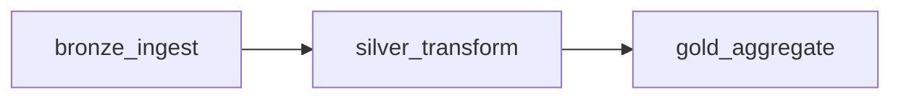

# Airflow DAG: `es_empenhos_pipeline`

Source: `dags/es_empenhos_pipeline.py` (written for Airflow 2.9+).

## Overview

A single DAG that runs the three Medallion layers in order: Bronze ingestion of the
raw TCE-ES CSVs, Silver reconciliation and typing, and Gold aggregation. It does
not add a separate quality task: each layer's data quality checks
(`es_empenhos.quality.checks`) are called inside that layer's `run()` and raise on
failure, so a failed check fails the task that triggered it. The DAG has no
schedule (`schedule=None`) and is triggered on demand, because the source is
published as static yearly files and a periodic run would add nothing. It is
meant to run locally; the Docker Compose stack that will host it is not built yet
(see Known limitations).

## Tasks and dependencies



All three tasks are `BashOperator`s that call a layer's CLI module with
`python -m`. Each sets `SPARK_LOCAL_IP=127.0.0.1` (appended to the worker
environment) so Spark binds to loopback under WSL2.

| Task | Upstream | Input | Output | Quality check run inside |
|---|---|---|---|---|
| `bronze_ingest` | none | Raw CSVs in `raw_dir`, for the configured years | Parquet in `bronze_dir`, partitioned by provider (municipality) and year, with provenance columns | Provenance check (`check_bronze_provenance`) |
| `silver_transform` | `bronze_ingest` | Bronze Parquet | Silver Parquet: 55- and 58-column layouts reconciled, monetary and date columns typed, deduplicated | Municipality never null; monetary parse rate |
| `gold_aggregate` | `silver_transform` | Silver Parquet | Three tables under `gold_dir`: `spending_by_municipality_year`, `carryover_rate_by_municipality_year`, `supplier_concentration_by_municipality_year` | State share sums to one |

Table semantics are in [`gold-design.md`](gold-design.md); source layout and the
2023 to 2024 schema change are in [`data-profiling.md`](data-profiling.md).

## Parameters and configuration

The DAG reads **Airflow Variables** at DAG-parse time. Each has a default, so none
is required. It uses no Airflow Connections and no environment variables beyond
the hard-coded `SPARK_LOCAL_IP`.

| Variable | Default | Meaning |
|---|---|---|
| `es_empenhos_raw_dir` | `data/raw` | Where the raw CSVs live |
| `es_empenhos_bronze_dir` | `data/lake/bronze/empenhos` | Bronze output |
| `es_empenhos_silver_dir` | `data/lake/silver/empenhos` | Silver output |
| `es_empenhos_gold_dir` | `data/lake/gold` | Gold output |
| `es_empenhos_years` | `2023 2024` | Space-separated years passed to `--years` |

The defaults are relative paths, resolved against the working directory of the
Airflow worker process, not the repo root.

## How to run manually

With the package installed (`pip install -e .`) in the environment Airflow runs in:

```bash
airflow variables set es_empenhos_years "2024"   # optional
airflow dags unpause es_empenhos_pipeline        # first time only
airflow dags trigger es_empenhos_pipeline
```

In the UI: open the DAG `es_empenhos_pipeline`, unpause it, and press
**Trigger DAG**.

To run against the committed sample instead of the full data, point
`es_empenhos_raw_dir` at the `sample/` directory with `airflow variables set`.

## Known limitations

- **Not yet run end-to-end under Airflow.** The layers have been run through
  their CLIs; the DAG file itself has not been exercised in a scheduler, and the
  README still lists Airflow as *planned*.
- **No Docker Compose stack exists yet.** There is no Dockerfile or compose file in the
  repo, so "runs via Docker Compose" is the intended target, not current state.
- **Spark is single-node and in-process.** Each task starts its own local
  `SparkSession` inside the worker; there is no cluster.
- **No per-run parameters.** The docstring in the DAG file suggests
  `airflow dags trigger --conf '{"years": ...}'`, but the DAG does not read
  `dag_run.conf`. Years and paths come only from Variables, read at parse time,
  so changing them affects every later run.
- **No retries, SLAs, alerting or sensors.** Default task settings apply, and the
  DAG does not check that raw files exist before starting.
- **Outputs are overwritten, not scoped per run.** Each layer writes with
  `mode("overwrite")` to a fixed path, so a rerun replaces the previous output
  and there is no run history or backfill.
- **Quality checks are coupled to the layer code.** A failure appears as a failed
  `BashOperator`, with the reason in the task log rather than as a separate task.
